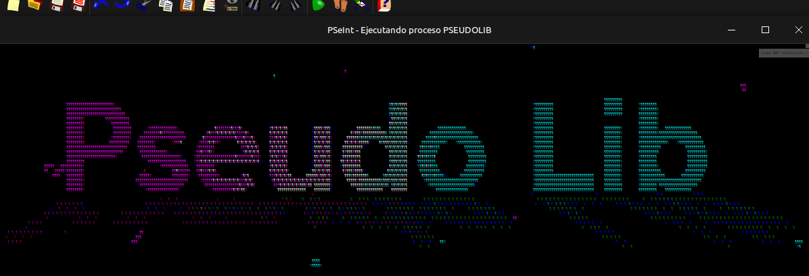
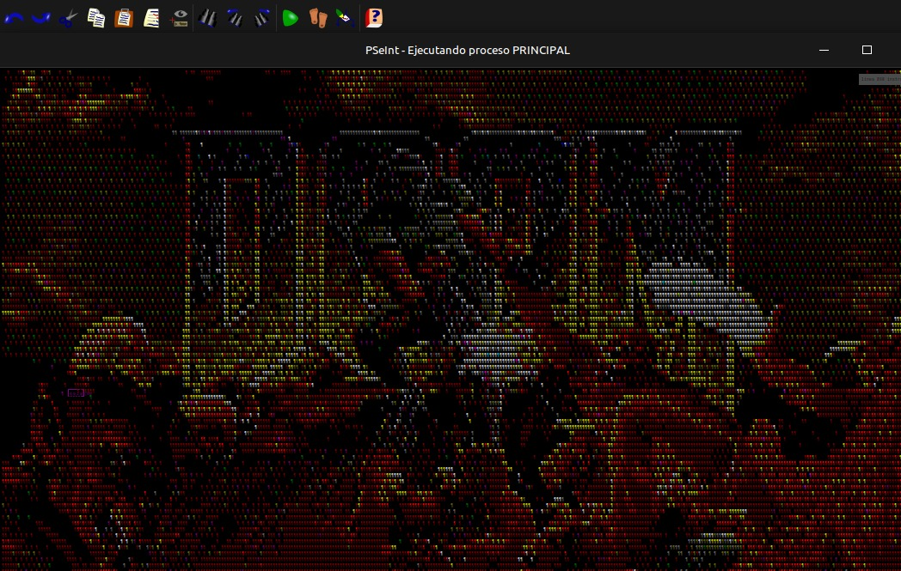
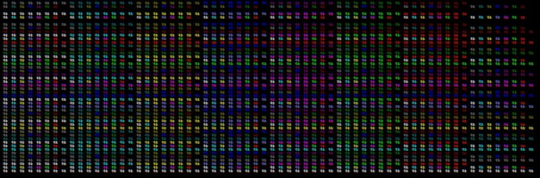
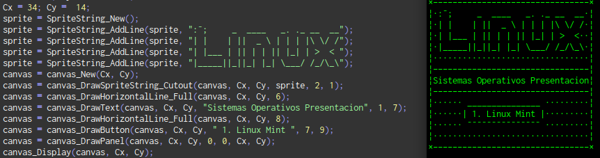

---

PseudoLib es una librería de pseudocódigo desarrollada para PSeInt. Su objetivo es ampliar las posibilidades del entorno mediante la simulación de estructuras y funciones que no ofrece de forma nativa. Se basa principalmente en Java, con ideas de JavaScript, C y otros lenguajes, sin reproducir fielmente uno en particular.

**Versión actual: 0.9.7** · La versión anterior, 0.9.3, se conserva en [src/PseudoLib_old.psc](src/PseudoLib_old.psc). El código actual está en [src/PseudoLib.psc](src/PseudoLib.psc).

> [!IMPORTANT]
> Este proyecto es experimental y no tiene un fin pedagógico específico. Para su uso y comprensión se requieren bases de programación. Puede utilizarse para explorar las funciones y observar su comportamiento.

---
## Media

*Imagen de Doom dibujada mediante caracteres y color en PSeInt; no corresponde a la ejecución del juego.*

*Simulación de color de 9 bits a partir de colores de 4 bits mediante tramas de caracteres en la consola.*

*Interfaz dibujada en la consola de PSeInt.*

---
## Modules 

Módulos de la versión **0.9.7**. El estado “Stable” se refiere al desarrollo dentro de este proyecto experimental y no garantiza la ausencia de errores.

| NAME MODULE              | USE                          | STATE |
| :----------------------- | :--------------------------- | :---: |
| NATIVE                   | `native_`                    |  `[+]` |
| INPUT                    | `user_input_`                |  `[+]` |
| STRING                   | `string_`                    |  `[+]` |
| ARRAY                    | `array_`                     |  `[p]` |
| PRINTERS                 | `print_ : prinln_`           |  `[p]` |
| SLEEP                    | `sleep_`                     |  `[+]` |
| LOGS                     | `log_`                       |  `[+]` |
| TEST                     | `test_`                      |  `[+]` |
| NUMBER                   | `int_ / number_ / float`     |  `[+]` |
| BINARY_STRING            | `binarystring_`              |  `[+]` |
| MATH                     | `math_`                      |  `[+]` |
| BOOLEAN                  | `boolean_`                   |  `[+]` |
| COLOR                    | `COLOR_`                     |  `[+]` |
| VALUE                    | `value_`                     |  `[+]` |
| TAG                      | `tag_`                       |  `[+]` |
| POINTER_STRING           | `stringPointer_`             |  `[+]` |
| COLLECTION               | `collection_`                |  `[+]` |
| COLLECTION_UNIFORM       | `collectionUniform_`         |  `[+]` |
| COLLECTION_ROUTED        | `collectionRouted_`          |  `[+]` |
| COLLECTION_DICTIONARY    | `collectionDictionary_`      |  `[p]` |
| COLLECTION_DUAL_UNIFORM  | `collectionDualUniform_`     |  `[x]` |
| COLLECTION_DICTIONARY_TYPED | `collectionDictionaryTyped_` | `[x]` |
| DEQUE                    | `util_deque_`                |  `[+]` |
| QUEUE                    | `util_queue_`                |  `[+]` |
| STACK                    | `util_stack_`                |  `[+]` |
| TEMPORAL\CHRONO_UNIT     | `temporal_ : chrono_unit`    |  `[+]` |
| LOCALDATE                | `localDate_`                 |  `[+]` |
| LOCALTIME                | `localTime_`                 |  `[+]` |
| LOCALDATE_TIME           | `localDate_time_`            |  `[+]` |
| DURATION                 | `duration_`                  |  `[+]` |
| PERIOD                   | `period_`                    |  `[+]` |
| LIST                     | `util_list_`                 |  `[+]` |
| SET                      | `util_set_`                  |  `[+]` |
| MAP                      | `util_map_`                  |  `[p]` |
| OBJECTS                  | `object_`                    |  `[x]` |
| CANVAS                   | `canvas_`                    |  `[+]` |
| SPRITE                   | `sprite_`                    |  `[p]` |
| TUI                      | `tui_`                       |  `[x]` |
| TCOMPONENT               | `tComponent_`                |  `[p]` |
| SCHEME                   | `scheme_`                    |  `[x]` |
| VEC                      | `vec_`                       |  `[x]` |
| ASCII/HASH               | `ascii_`                     |  `[+]` |
| CONSOLE                  | `console_`                   |  `[+]` |

> [!NOTE]
> 0.9.7 | `pseint.2023` | 43 entradas en la tabla de módulos, incluidas las pendientes.

### Dependencias entre módulos

*Relaciones y dependencias entre módulos. [Ver el SVG completo](media/grafico%20de%20modulos.svg).*

---

#### State module

| STATE | DESCRIPTION                                 |
| :---: | :------------------------------------------ |
| `[+]` | Stable                                      |
| `[D]` | Current Development (Unusable temporarily)  |
| `[p]` | Stable (Pending additions)                  |
| `[x]` | Unusable / undeveloped state                |

### Herramientas y documentación

- [Generador de imágenes para PSeInt](web_tools/ImageGenerator.html).
- [Build PseudoLib](web_tools/Build_PseudoLib/index.html): herramienta para integrar código y sus dependencias. [Instrucciones](web_tools/Build_PseudoLib/README.md).
- [Wiki de módulos](documentation/wiki/modules): puede presentar diferencias con la versión actual. El código de la 0.9.7 es la referencia principal.

---

#### Próximamente / En desarrollo

- Algoritmos de ordenamiento de arreglos compatibles con la estructura String 
- Vectores Cruz y Punto a partir de Cadenas y arreglos
- Regex(Pattern/Matcher)
- QR

> [!NOTE]
> La mayoría de cosas complejas se manejan mediante asignaciones y texto.
> Es simulación, con el objetivo de programar cosas complejas con flexibilidad.
